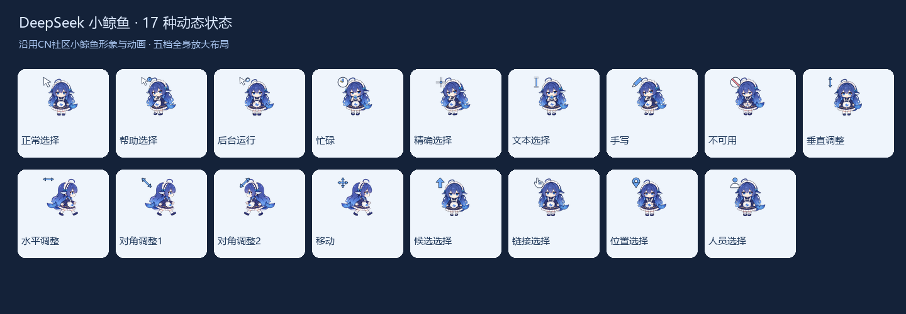
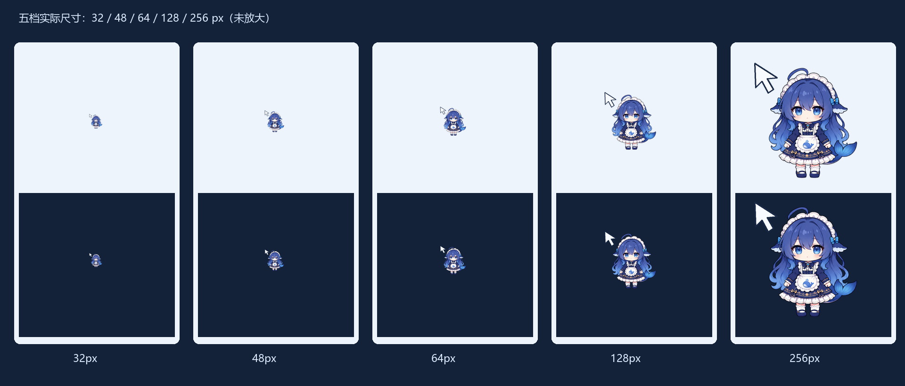

# DeepSeek 小鲸鱼 · Q版动态鼠标指针

沿用此前从CN社区找到并用于动画的深蓝长发小鲸鱼娘：女仆裙、围裙鲸鱼图案与鲸尾。角色素材作者 **YunYueSama**，来源 https://github.com/YunYueSama/codex-deepseek-pet 。本项目将已有透明动作图集改编为Windows动态指针，角色设计保持原样；这是社区作品，非DeepSeek官方产品。



包含17种动态状态、32 / 48 / 64 / 128 / 256px五档，共85个ANI。五档都减少透明留白、缩小功能符号，让完整角色尽量占满画布。点击热点固定在功能符号上。32px优先保证轮廓与动作可辨认；细小裙饰在大尺寸更清楚。默认推荐64px。

正常选择眨眼，链接与人员选择挥手，调整窗口时走动或跳跃，帮助/手写时思考，忙碌时抱着小鲸鱼，不可用时露出小失落。待机、挥手、行走、跳跃来自原社区连续动画；思考、抱鲸鱼、失落使用原社区表情加轻微呼吸位移。向左行走镜像复用原向右序列。源码保留精确帧索引和处理参数。

## 下载与安装

整合安装包（含五档）：https://github.com/nibushiyigeren123-bot/DeepSeek-mint-cursors/raw/refs/heads/main/downloads/deepseek-mint-cursors-v1.0.0.zip

可选原始PNG编辑帧包：https://github.com/nibushiyigeren123-bot/DeepSeek-mint-cursors/raw/refs/heads/main/downloads/deepseek-editable-frames-v1.0.0.zip

1. 下载整合包，完整解压后再运行文件。
2. 推荐双击 `应用_DeepSeek_64px.cmd` 安装并应用。另有32、48、128、256px对应CMD，选择一档即可；无参数运行 `install.ps1` 也默认64px。
3. 首次安装一档后，手动双击 `尺寸保持_开启.cmd`。组件在本机用Windows .NET编译，并登记当前用户登录启动，用来在Windows重载后恢复本包所选尺寸。
4. 以后换大小，直接双击目标尺寸CMD。**不要拖动Windows“鼠标指针大小”滑块**，该操作可能使自定义方案恢复成默认指针。误调后重新运行目标尺寸CMD，必要时再次开启尺寸保持。

喜欢传统安装方式，可以右键 `安装_DeepSeek_64px.inf` →“安装”。Windows 11可能需先选“显示更多选项”。五档各有独立INF，右键安装只复制文件并登记对应方案；随后到“控制面板 → 鼠标 → 指针”选择 `DeepSeek Mint 64px` 并应用，再手动开启尺寸保持。INF本身不启动组件，不保证Windows默认重载时显示指定真实像素。

完整操作、关闭与恢复见 [使用说明](使用说明.md)，评论区可直接粘贴 [评论版说明](B站评论使用说明.txt)。本包不分发预编译EXE；无需关闭Windows安全防护。管理员/浏览器安全提示取决于本机环境，不承诺完全没有提示。

DeepSeek和Astra/sol使用独立安装目录、方案名、登录项、互斥锁/停止事件、备份目录。它们可以同时登记；当前系统生效的方案只有一套，尺寸保持只响应自己的完整17状态方案。



## 展示视频与投稿

[47秒完整演示](previews/showcase.mp4)：1080p、30fps，模拟光标运动、全部17状态和五档原生尺寸。状态演示中的光标局部放大2倍，尺寸对照部分保持原生像素。

已配BGM《放課後アフタースクール》，作曲watson；フリーBGM・音楽素材MusMus https://musmus.main.jp/ 。音乐0.7秒淡入、3秒淡出；[官方使用条款](https://musmus.main.jp/info.html)。音乐只用于展示成片，仓库不分发独立音源。标题与简介见 [B站投稿文案](B站投稿文案.md)，投稿请保留角色与音乐署名。

## 源码、验证和维护

```powershell
python -m pip install -r requirements.txt
python source/build_cursors.py
python scripts/validate_cursors.py
python source/render_showcase.py
python source/add_showcase_bgm.py source/video/showcase-captioned-silent.mp4 YOUR_MUSMUS_BGM_174.mp3 showcase-bgm.mp4 --wav showcase-bgm.wav
```

代码使用Windows字体，视频依赖FFmpeg。仓库的`source/characters`保留社区原始PNG图集，`source/provenance.json`记录来源网址与SHA256；`source/action-recipe.json`记录帧选择。安装整合包附整理后的`deepseek-actions.png`和参数即可重建全部指针，不把大型社区原始图集重复塞入安装ZIP；原始图集仍完整保留在仓库和本地正式档案。整理后的动作像素与原编译结果完全一致，85ANI逐字节相同。动作整组共用透明裁切范围、比例与锚点，保留动画位移，不逐帧拉伸人物。`source/frames`是生成结果，共700PNG，Git不追踪；运行生成器即可重建，或下载可选编辑帧包。

需要调整原动画选帧时，在完整源码仓库中修改`source/build_cursors.py`的`ACTION_SPECS`，运行`python source/prepare_actions.py`重新整理动作，再运行生成器和验证器。普通重建直接运行上述命令即可。

`validation.json`记录85个文件的Windows LoadImage/GetIconInfo/DrawIconEx加载、所有动画帧绘制、颜色与热点检查。`installation-validation.json`记录五INF的Windows SetupAPI隔离复制/登记、五CMD真实子进程入口、无参数64px、备份恢复/失败回退和尺寸保持选档白名单。隔离测试替换系统应用调用或重定向注册表，未切换用户当前指针；这些记录不冒充新包的现场安装、鼠标面板或登录启动验收。

完整本地工程另外保留无配乐成片、干净视频轨、SRT、WAV、原音源、参数/版本和测试回执，并正式归档。

## 来源与许可

作者：YunYueSama

社区素材仓库：https://github.com/YunYueSama/codex-deepseek-pet

修改：透明图集取帧、缩放/布局、动作编排、轻微呼吸位移、功能符号及ANI编码；未改角色设计。

社区素材附完整 [大肥鱼项目署名许可1.0](LICENSE-ART.txt) 与原 [素材说明](ASSET_LICENSE.md)，其授权范围与第三方参考边界按原文执行。新增指针代码采用 [MIT](LICENSE-CODE)，代码许可不替代美术/角色或品牌权利。原参考图的作者边界按社区项目说明保留，不冒称官方授权。
